# 같은 날씨, 다른 피해
### 폭염·호우에 따른 강남·춘천 상권의 기후 취약성 분석과 예보 연동 지원 방안

> 2026 빅콘테스트 AI데이터 분석 분야 · 「기후 위기에 따른 취약 상권 영향 분석」
> 팀 **가뭄에콩나듯** · 염서윤, 권성미 · 2026.09 – 2026.10


> **데이터 안내**: 대회 제공 데이터(신한카드, SK 유동인구)와 이를 가공한 파일은 대회 규정에 따라 이 저장소에 포함하지 않습니다. 노트북은 출력을 지운 상태로 올렸습니다.

---

## 목차
1. [프로젝트 개요](#1-프로젝트-개요)
2. [데이터](#2-데이터)
3. [분석 파이프라인](#3-분석-파이프라인)
4. [핵심 결과](#4-핵심-결과)
5. [예측 모델 성능](#5-예측-모델-성능)
6. [지원 방안과 대시보드](#6-지원-방안과-대시보드)
7. [폴더 구조와 노트북](#7-폴더-구조와-노트북)
8. [실행 방법](#8-실행-방법)
9. [팀원과 역할](#9-팀원과-역할)

---

## 1. 프로젝트 개요

**질문**: 같은 폭염·호우가 와도 상권마다 잃는 매출은 다르지 않을까?

대도시 중심 상권인 **서울 강남구**와 관광·여가 비중이 큰 **강원 춘천시**를 비교해 네 가지를 답했습니다.

| | 질문 | 방법 | 노트북 |
| --- | --- | --- | --- |
| Q1 | 폭염·비·호우가 오면 어느 지역·업종·연령의 매출이 얼마나 줄었나? | OLS 회귀 + FDR 보정 | 06 · 08 |
| Q2 | 날씨를 넣으면 매출을 더 잘 맞히고, 비 오기 전에 피해를 예상할 수 있나? | LightGBM, walk-forward 검증, 시나리오 | 07 · 07b |
| Q3 | 피해가 몰리는 상권은 어떤 성격이고 어디에 있나? | 50m 격자 K-평균, 격자별 예상 감소율 | 14 · 15 · 16 |
| Q4 | 언제, 누구를, 어떻게 지원해야 하나? | 우선 지원 알고리즘, 대시보드 | 16 · 17 |

## 2. 데이터

| 데이터 | 단위 | 기간 | 출처 |
| --- | --- | --- | --- |
| 신한카드 매출 | 일 × 지역 × 업종(13개 그룹) · 연령 · 외지인 | 2025.7–12 | 대회 제공 (미포함) |
| SK 유동인구 | 50m 격자 · 성·연령·요일·시간대 | 2025.7–12 월평균 | 대회 제공 (미포함) |
| 기상 관측 | 시간 → 일, 서울(108)·춘천(101) | 2025.7–12 | 기상청 ASOS ([`data/external`](data/external)) |
| 행정동 경계 | 행정동 | 2025-01-01 | [vuski/admdongkor](https://github.com/vuski/admdongkor) ([`data/external/adm`](data/external/adm)) |
| 골프장·레고랜드 좌표 | 시설 13곳 | 2026-10 수집 | 구글 지도에서 직접 확인 ([`data/external`](data/external)) |
| 상가(상권)정보 | 점포 좌표·업종 | 2025-06 | 소상공인시장진흥공단, 공공데이터포털 (용량 초과로 미포함) |

**날씨 정의**: 폭염 = 일 최고기온 33℃ 이상 · 비 = 일 강수 1mm 이상 · 호우 = 30mm 이상
(2025년 7~9월 폭염일 24일, 호우일 강남 12일 · 춘천 14일)

**주요 정제 기준** (자세한 분류표는 [`docs/`](docs))
- 법인 카드 제외, 카드 업종 91개 → 13개 그룹 (날씨와 무관한 정기결제·전문서비스·고액 내구재 제외)
- 외지인 = 고객 거주 시도 ≠ 가맹점 시도
- 시간대는 06–11 · 12–17 · 18–23시 3구간 (00–05시 제외)

<table><tr><td width="50%" valign="top" align="center">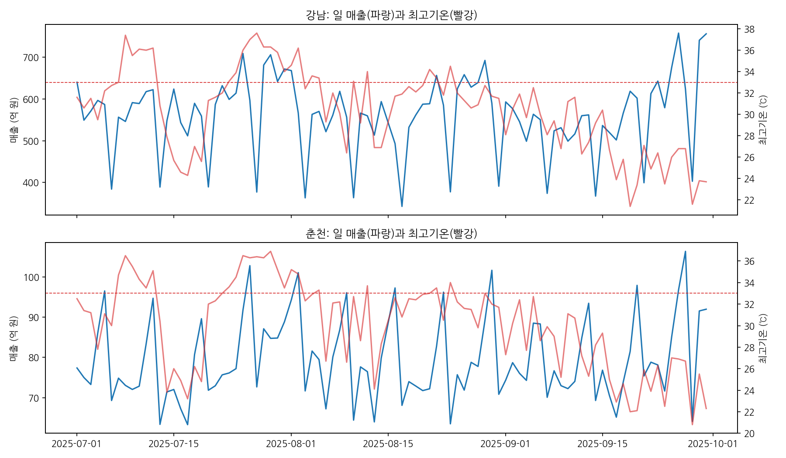<br><sub>일 매출(파랑)과 최고기온(빨강), 빨간 점선 = 폭염 기준 33℃</sub></td><td width="50%" valign="top" align="center">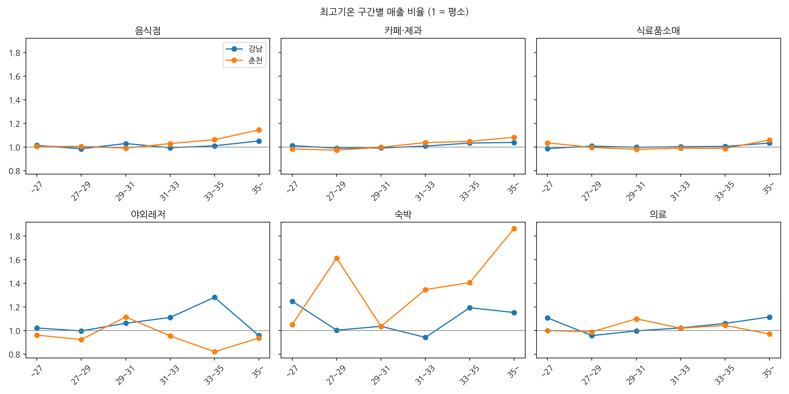<br><sub>최고기온 구간별 업종 매출 비율 (1 = 평소)</sub></td></tr></table>

## 3. 분석 파이프라인

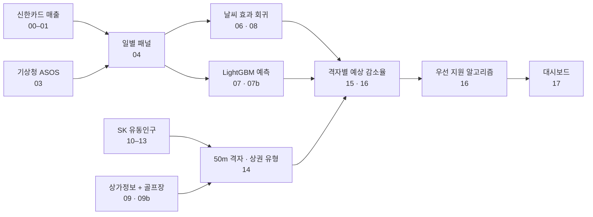

## 4. 핵심 결과

| 구분 | 강남 | 춘천 |
| --- | --- | --- |
| 호우일 매출 변화 (FDR 보정 후 유의) | 없음 | 야외레저 **−53.4%**, 카페·제과 −8.4%, 자동차 −8.0% |
| 폭염일 매출 변화 (FDR 보정 후 유의) | 없음 | 60대 이상 여가·외출형 **−18.9%** |
| 호우 × 연령 (FDR 보정 후 유의) | 없음 | 60대 이상 여가·외출형 −44.9%, 40~50대 −35.7% |
| 추정 피해 (2025.7~9) | 없음 | 호우 약 **50.0억 원**, 폭염 약 4.8억 원 |
| 기후 취약 격자 (예상 감소율 5% 이상) | 0칸 | 380칸 (이중 취약 31칸, 87%가 낮·고령형) |

- 78개 검정(13업종 × 2지역 × 3날씨)에 FDR(BH) 보정을 적용해 우연히 나온 결과를 걸렀습니다.
- 폭염 기준을 31·32℃·체감 33℃로, 호우 기준을 20·50mm로 바꿔도 춘천 야외레저 호우 효과는 −51.5% ~ −58.0%로 유지됐습니다.
- 회귀분석(06)과 예측 모델(07)이 같은 고취약 25칸(골프장·레고랜드·중앙시장 일대)을 짚었습니다.

<table><tr><td width="50%" valign="top" align="center">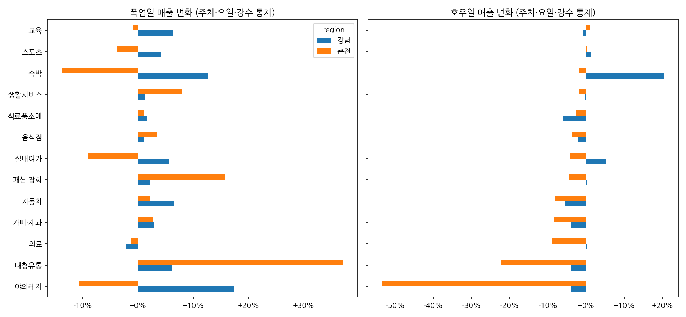<br><sub>업종 × 지역 날씨 효과 (06, 보정 전 추정치)</sub></td><td width="50%" valign="top" align="center">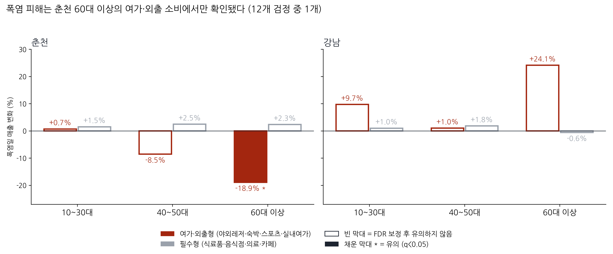<br><sub>폭염일 연령 × 소비 유형별 매출 변화 (06 H4)</sub></td></tr></table>

<table><tr><td width="50%" valign="top" align="center">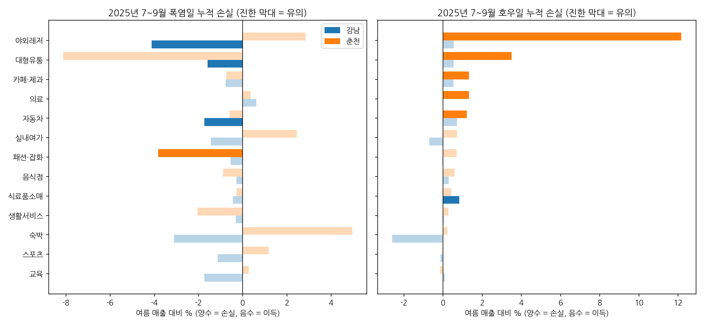<br><sub>2025년 7~9월 업종별 누적 추정 손실, 진한 막대 = 유의 (08)</sub></td><td width="50%" valign="top" align="center">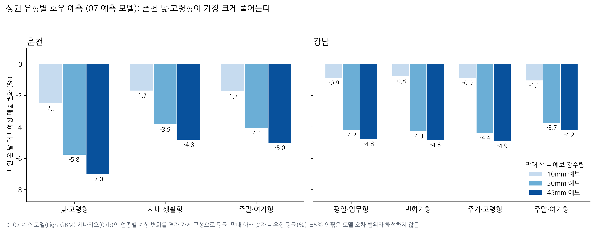<br><sub>상권 유형별 호우 예측, 10·30·45mm (07 모델)</sub></td></tr></table>

<p align="center">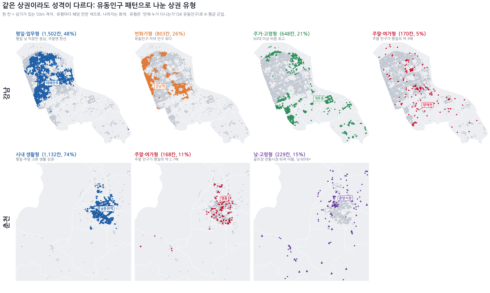<br><sub>유동인구 패턴으로 나눈 상권 유형 (14)</sub></p>

<p align="center">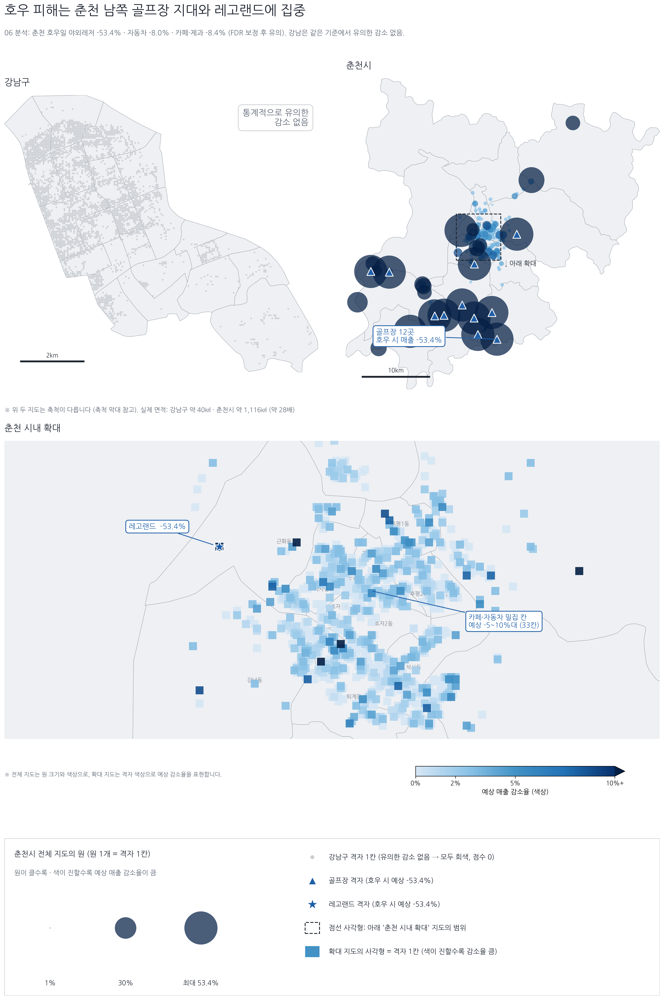<br><sub>격자별 호우 예상 매출 감소율 (15)</sub></p>

## 5. 예측 모델 성능

- **모델**: ① 지난주 같은 요일 매출(기준) ② LightGBM 날씨 없음(10개 변수) ③ LightGBM 날씨 포함(19개 변수)
- **검증**: 매달 앞으로 밀며 예측하는 walk-forward 5회 (7월→8월 … 7~11월→12월), 날짜 × 지역 × 업종 4,602행
- **지표**: WAPE (매출 가중 오차, %)

| 구간 | ① 기준 | ② 날씨 없음 | ③ 날씨 포함 | ②→③ 개선 |
| --- | ---: | ---: | ---: | ---: |
| 전체 | 17.86 | 18.32 | **16.99** | 7.3% |
| 폭염일 | 16.76 | 17.49 | **15.28** | 12.6% |
| 호우일 | **14.27** | 19.86 | 15.50 | 22.0% |
| 춘천 호우일 | 22.59 | 25.34 | **19.34** | 23.7% |
| 춘천 야외레저 호우일 | 73.18 | 65.91 | **45.29** | 31.3% |

강남 호우일은 ①이 가장 정확했습니다. 강남 매출이 비에 거의 반응하지 않는다는 06 결과와 같습니다.
45mm 호우 시나리오에서 춘천 야외레저 매출은 −34.6%로 예측됐습니다(07b).

<table><tr><td width="50%" valign="top" align="center">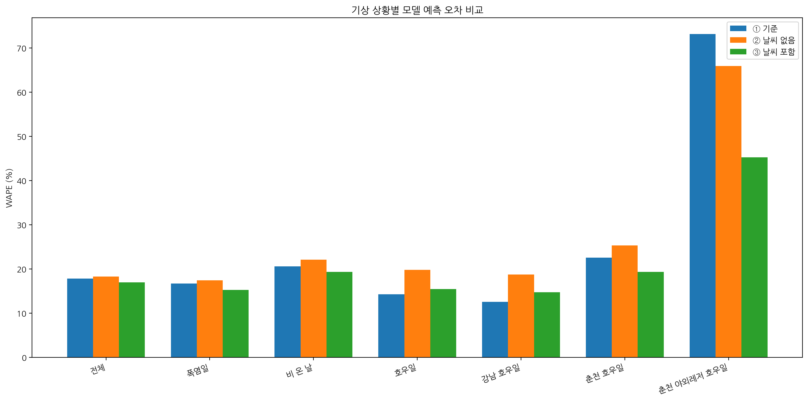<br><sub>기상 상황별 예측 오차 (WAPE)</sub></td><td width="50%" valign="top" align="center">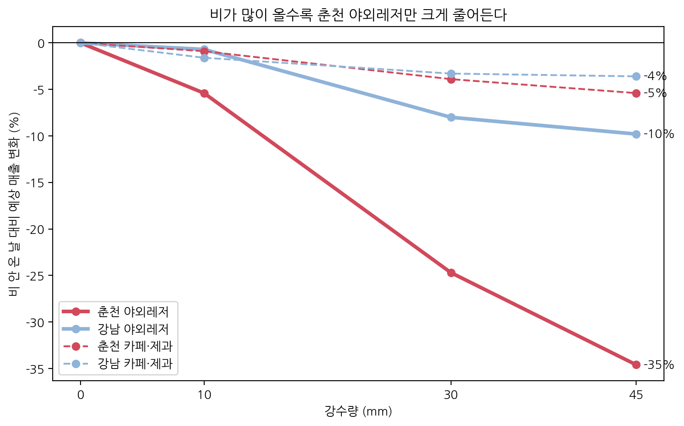<br><sub>강수량 시나리오별 예상 매출 변화 (07b)</sub></td></tr></table>

<p align="center">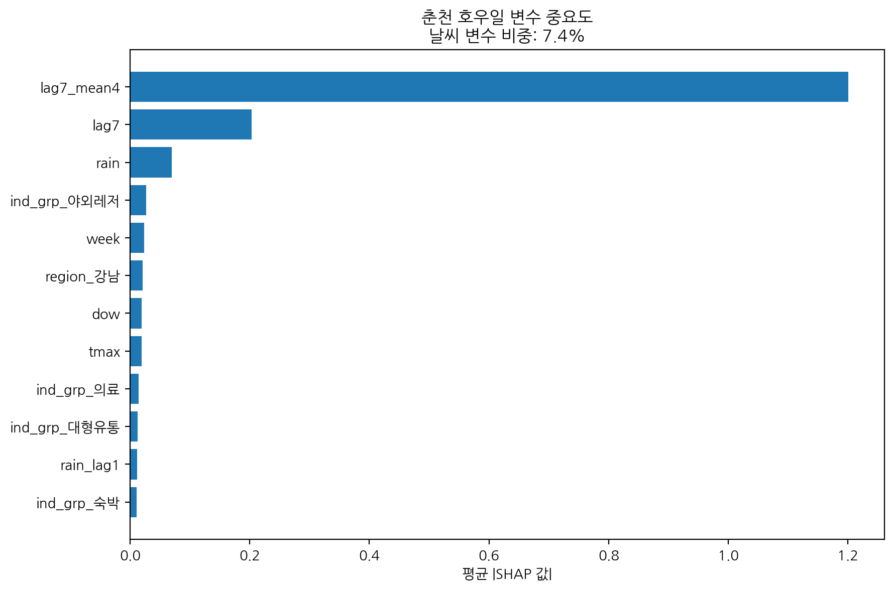<br><sub>춘천 호우일 변수 중요도 (SHAP): 강수량이 7위 → 3위로 상승</sub></p>


## 6. 지원 방안과 대시보드

| 지역 · 날씨 | 대상 | 방식 |
| --- | --- | --- |
| 춘천 · 호우 (메인) | 외지인 관광객 → 시내 소상공인 | 예보 연동 '우천 안심 혜택' (10mm 1단계 · 30mm 2단계) |
| 춘천 · 폭염 (보조) | 낮·고령형 상권의 60대 이상 | 냉방 버스정류장, 시장 냉방 쉼터·쿨링포그 |
| 강남 | 상권 전체 | 모니터링 (분기마다 06 재추정) |

`17_dashboard`를 실행하면 `outputs/dashboard/dashboard.html` 파일 하나가 만들어지고, 인터넷 없이 열립니다.
- **관광객 화면**: 예보 강수량 → 혜택 신호등 → 받을 수 있는 혜택, 제휴처 후보, 비 오는 날 코스
- **시청 화면**: 예보 입력 → 우선 지원 행정동, 호우·폭염 취약 지도, 강남 vs 춘천 비교 (대회 데이터 기반이라 비공개)

## 7. 폴더 구조와 노트북

```
├── README.md
├── requirements.txt
├── .gitignore            대회 데이터 폴더 제외
├── notebooks/            00 ~ 17 (출력 지운 버전, 02 결번)
├── docs/                 업종 분류표 (팀 작성)
├── data/
│   ├── README.md         데이터 배치 방법
│   └── external/         공개 외부 데이터 (기상, 행정동 경계, 골프장·레고랜드 좌표)
└── outputs/
    └── figures/          보고서 그림
```

| 번호 | 노트북 | 내용 |
| --- | --- | --- |
| 00–01 | `00_card_explore`, `01_card_preprocess` | 카드 데이터 탐색, 업종 13개 그룹 정리 |
| 03 | `03_weather_preprocess` | 기상 데이터 정리, 체감온도, 폭염·비·호우 정의 |
| 04 | `04_merge_panel` | 카드 + 날씨 결합 |
| 05 | `05_eda` | 탐색적 분석 |
| 06 | `06_effect_analysis` | 날씨 효과 회귀분석 (업종·지역·연령·시간대, FDR, 강건성) |
| 07 · 07b | `07_model`, `07b_scenario` | LightGBM, walk-forward, SHAP, 강수량 시나리오 |
| 08 | `08_damage` | 추정 손실액 |
| 09 · 09b | `09_store_preprocess`, `09b_add_golf` | 상가정보 좌표·업종, 골프장·레고랜드 추가 |
| 10–13 | `10_sk_explore` ~ `13_sk_eda` | SK 유동인구 정리, 50m 격자 좌표, EDA |
| 14 | `14_store_grid` | 점포 → 격자 연결, 격자 지표, K-평균 상권 유형 |
| 15 | `15_climate_vulnerability_map-fixed` | 격자별 예상 감소율, 취약 지도 |
| 16 | `16_report_analysis` | 취약 상권 정의, 피해 규모, 상권별 예측, 우선 지원 알고리즘 |
| 17 | `17_dashboard` | 예보 연동 지원 대시보드 HTML |

> 15번 노트북 앞부분의 등급형 지수(heat_index·rain_index)는 초기 버전이며, 최종 결과는 마지막 셀의 06 회귀 기반 예상 감소율(heat_score·rain_score)입니다.

## 8. 실행 방법

1. 이 저장소를 Google Drive `MyDrive/` 아래에 두고 폴더 이름을 **`bigcontest-2026`**으로 바꿉니다. 노트북은 `/content/drive/MyDrive/bigcontest-2026` 경로 기준입니다.
2. [`data/README.md`](data/README.md)대로 대회 데이터와 상가정보를 넣습니다.
3. Google Colab에서 노트북을 번호 순서대로 실행합니다.

- 패키지: [`requirements.txt`](requirements.txt)
- 한글 폰트: 노트북 첫 셀의 `apt-get install fonts-nanum` 실행 후 런타임 다시 시작

## 9. 팀원과 역할

| 이름 | 역할 | 노트북 |
| --- | --- | --- |
| 염서윤 | 카드·기상 전처리, 날씨 효과 회귀, 예측 모델, 피해 추정, 상권 격자 연결, 우선 지원 알고리즘, 대시보드 | 00–09b, 14, 16, 17 |
| 권성미 | SK 유동인구 전처리·좌표·EDA, 폭염·호우 취약 지도 | 10–13, 15 |

---

**데이터 취급**: 대회 제공 데이터와 이를 가공한 데이터는 저장소에 포함하지 않으며 대회 종료 후 삭제합니다. 저장소에는 팀이 직접 수집한 공개 외부 데이터와 팀이 만든 업종 분류표만 포함합니다.
